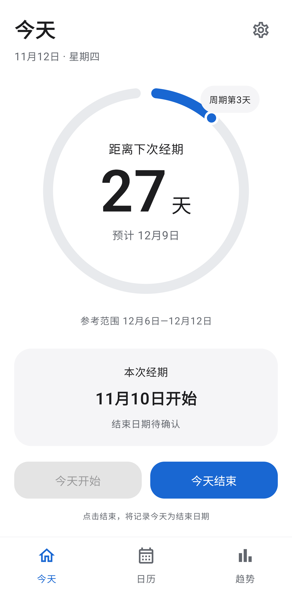
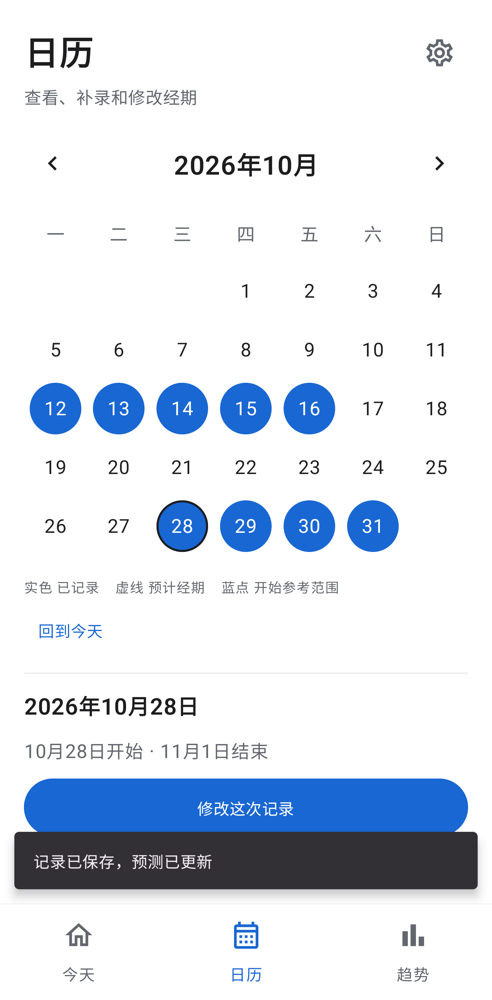
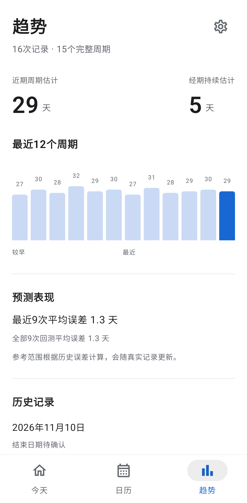

# periods2note · 经期记录

一个原生 Android 离线经期记录 App。用真实开始日期估计下一次经期，记录变化后重新计算，并展示历史误差和参考范围。

**无需注册、无需联网、没有广告。公开版不附带个人记录，首次启动为空。**

[下载最新版 APK](https://github.com/shawncai/periods2note/releases/latest) · [算法实现](app/src/main/java/com/period/local/domain/PredictionEngine.kt) · [发布验收](docs/RELEASE-VERIFICATION.md)

## 界面预览

下面是 Android 真机上使用**程序生成的虚构数据**运行的截图，不包含任何人的真实经期记录。演示数据仅存在于测试代码，不会预装到发布版。

<table>
  <tr>
    <th>今天</th><th>日历</th><th>趋势</th>
  </tr>
  <tr>
    <td></td>
    <td></td>
    <td></td>
  </tr>
</table>

## 可以做什么

- **今天**：查看预计开始日期、距离预计日期的天数、参考范围；点击“今天开始”或“今天结束”直接保存当天日期。
- **日历**：补录过去的开始和结束日期，修改已有记录；区分已记录经期、预测经期和开始日期参考范围。
- **趋势**：查看最近 12 个周期、持续时间估计、近期与全部回测误差，以及历史记录。
- **本地备份**：导出 JSON，换机后导入恢复；支持兼容字段的美柚记录数组，导入前预览重复与冲突项。
- **状态校验**：已有未结束记录时不能重复开始；同一天不新建重叠记录；允许开始当天结束。

补录、修改统一放在日历页。日期填错时，在日历选择已记录日期，点击“修改这次记录”。过去遗漏的结束日期也在这里补齐。

## 自适应预测算法

算法版本为 **`weighted-12-v1`**。它是一个基于近期历史的确定性统计估计，不依赖云端模型或训练服务。“自适应”指每次新增、修改或导入记录后，用当时的实际数据重新计算基线、范围和历史误差。

### 1. 从开始日期得到周期

将记录按开始日期升序排列：`S₀, S₁, …, Sₙ`，相邻开始日期之间的自然日数为周期长度：

```text
Cᵢ = daysBetween(Sᵢ, Sᵢ₊₁)
```

`n + 1` 条开始记录对应 `n` 个完整周期间隔。“完整周期”指两个开始日期已知，不要求前一条的结束日期已填写。结束日期用于单独估计经期持续时间，不用于计算周期长度。

- 只从日期重新计算间隔，忽略导入文件附带的周期统计字段。
- 短周期和长周期都保留；算法不会自动删掉看起来异常的间隔。
- 如果漏记一次开始日期，算法会把跨过那次经期的长间隔当成真实周期；应先在日历补齐记录。
- 少于 **3 个完整周期**时显示“数据积累中”，不输出下一次预计日期。

### 2. 最近最多 12 个周期的指数加权平均

选取最近 `m = min(n, 12)` 个周期。最新周期权重为 `1`，每向前一个周期乘以 `0.8`：

```text
由新到旧的权重：1, 0.8, 0.64, 0.512, …

周期估计 = round(Σ(C × 权重) / Σ权重)
预计开始日期 = 最近一次开始日期 + 周期估计
```

代码使用 Kotlin `roundToInt()` 四舍五入为整数天。最多使用 12 个周期，避免很久以前的数据长期主导当前日期；旧周期仍会在历史回测中参与其对应时点的评估。

**虚构示例**：由旧到新的三个周期为 `28、30、32` 天：

```text
(28 × 0.64 + 30 × 0.8 + 32 × 1) / (0.64 + 0.8 + 1)
≈ 30.3 天 → 30 天
```

若最后一次开始日期为 10 月 1 日，则预计下一次为 10 月 31 日。后续记录变长时，较大的新间隔获得更高权重，估计会逐步增大；变短时则相反。

### 3. 按时间顺序滚动回测，避免使用未来数据

至少已有 **6 个历史周期**时，才开始预测其后的下一次开始日期。每个历史时点只使用那个时点已经结束的周期间隔：

```text
for i in 6 until 周期总数:
    已知周期 = C[0 until i]
    当时预测 = S[i] + weightedCycle(已知周期)
    后来实际 = S[i + 1]
    绝对误差 = abs(daysBetween(当时预测, 后来实际))
```

这意味着第 7 个周期第一次被回测，拥有 `n` 个完整周期时最多得到 `n - 6` 次误差。每次回测内部依然只取当时最近 12 个周期。测试会将每个回测结果与对应历史前缀的独立预测比对，验证不存在未来数据泄漏。

### 4. 用经验误差给出参考范围

回测误差至少 **5 次**时：

1. 取最近最多 **20 次绝对误差**。
2. 从小到大排序，使用 nearest-rank 定义的第 80 百分位：第 `ceil(0.8 × 样本数)` 个值，序号从 1 开始。
3. 范围半宽 `H = max(3, 第 80 百分位误差)`。

```text
参考范围起点 = max(最近开始日期 + 1 天, 预计日期 − H)
参考范围终点 = 预计日期 + H
```

回测误差不足 5 次时，使用**所有已有周期间隔**相对当前周期估计的最大绝对偏差作为半宽，仍至少 3 天。比如 `28、30、32` 天估计为 30 天，最大偏差为 2 天，最终半宽使用 3 天。

这是用历史误差形成的**经验参考范围**，不是经过临床校准的置信区间，也不代表下一次一定有 80% 的概率落在范围内。历史少、周期突然变化或漏记都会使预测变差；误差较大时应直接看界面中的误差天数。

### 5. 误差如何展示

平均绝对误差（MAE）的单位是天：

```text
MAE = 所有绝对误差之和 / 回测次数
```

趋势页分别显示最近最多 12 次回测 MAE 和全部历史回测 MAE。没有回测数据时显示积累状态，而不会显示虚假的零误差。README 截图中的数字仅用于演示，不是个人数据或总体准确率。

预测对象同时包含：预计开始日期、参考范围起止、周期估计、估计所用样本量、完整周期总数、近期/全部 MAE、逐次回测结果和算法版本。

### 6. 经期持续时间单独估计

取最近 **6 条已填写结束日期的记录**：

```text
每次持续天数 = daysBetween(开始日期, 结束日期) + 1
估计持续时间 = 这些持续天数的中位数
```

开始和结束当天都计入。偶数样本取中间两项平均后四舍五入；尚未填写结束日期的记录不参与。没有已结束记录时不估计持续时间，日历只标记预计开始日。

### 7. 超过预计日期后怎么办

预计日期不会随着日历日期经过而自动向后移动。首页改为显示“已超过预计日期”和超出天数；可以在日历补录实际开始日期。只有真实记录变更才会改变预测基线。

本 App 用于个人记录和日程参考，**不提供排卵判断、避孕依据或诊断**。

## 安装与首次使用

1. 到 [Releases](https://github.com/shawncai/periods2note/releases) 下载 `periods2note-版本号-release.apk`。
2. Android 8.0 / API 26 及以上可以安装；如果系统提示，需要允许对应文件管理器安装应用。
3. 首次打开没有预置记录。可从首页记录今天，也可以在日历补录历史，或从右上角设置导入已有 JSON。
4. 累积至少 4 条开始记录后，即有 3 个完整周期，可以看到预测。

GitHub Release APK 使用独立发布签名。此前本地 Debug 测试版使用另一张签名证书，**不能直接覆盖安装**；如需切换，先在测试版导出备份，再卸载测试版、安装发布版并导入。以后使用同一发布签名的版本可覆盖更新并保留数据。请保存自己的备份，卸载会移除应用数据库。

## 数据格式、隐私与导入规则

应用没有 `INTERNET` 权限。记录存储在 Room / SQLite 的应用私有目录，系统云备份和系统设备迁移备份均禁用。用户主动导出的 JSON 是明文，保存位置由 Android 本地文件选择器决定。

仓库忽略所有 `*.json`、数据库、签名文件、旧安装包及本地验收资料；构建还会显式排除 `app/src/main/assets`，避免本地遗留记录被打包。发布版不包含真实或演示记录。

备份结构如下，以下日期是虚构示例：

```json
{
  "schemaVersion": 1,
  "exportedAt": "2026-01-01T00:00:00Z",
  "records": [
    { "id": "example-1", "start_date": "2025-12-01", "end_date": "2025-12-05" },
    { "id": "example-2", "start_date": "2025-12-30", "end_date": null }
  ]
}
```

也可导入直接包含 `start_date`、`end_date` 的数组；缺少 ID 时按开始日期生成稳定 ID。日期采用 ISO `YYYY-MM-DD`，结束日期可以为空。

- 文件上限 **2 MB**，最多 **10,000 条记录**。
- 完全重复的记录跳过，不重复增加数量。
- 相同 ID 或开始日期但内容不同时，导入预览显示冲突；默认保留当前记录，勾选后采用导入版本。
- 同一批导入在事务中整体提交；验证失败或中途失败时回滚。
- 拒绝重复开始日期、未来实际日期、结束早于开始及已知日期范围重叠。
- 编辑或预览后数据已改变时拒绝旧操作，避免静默覆盖新修改。

## 开发与构建

技术栈为 Kotlin、Jetpack Compose、Room 和 Gradle。核心算法是纯 Kotlin，日期使用 `java.time.LocalDate`，不按毫秒差计算，因此不受夏令时改变一天时长的影响。

| 项目 | 固定版本 |
| --- | --- |
| Gradle Wrapper | 8.11.1 |
| Android Gradle Plugin | 8.7.3 |
| Kotlin / Compose 编译器插件 | 2.3.0 |
| KSP | 2.3.0 |
| Compose BOM | 2025.02.00 |
| Room | 2.7.2 |
| compileSdk / targetSdk / minSdk | 35 / 35 / 26 |

需要 JDK 17 或以上、Android SDK 35。本项目验证环境使用 Android Studio 自带 JDK 21。用 `ANDROID_HOME` 指向 SDK，或者在本地 `local.properties` 设置 `sdk.dir`；该文件不提交。

```sh
git clone https://github.com/shawncai/periods2note.git
cd periods2note
./scripts/android.sh :app:testDebugUnitTest :app:lintDebug :app:assembleDebug
```

辅助脚本在 macOS 优先使用 Android Studio JDK，将构建缓存放在 `$HOME/Library/Caches/period-android`，Gradle 缓存放在 `$HOME/Library/Caches/period-gradle`。这样可避免外置盘 `._` 文件干扰 Android 资源编译。Linux 构建缓存位于 `${XDG_CACHE_HOME:-$HOME/.cache}/period-android`。可以通过 `JAVA_HOME`、`ANDROID_HOME` 和 `PERIOD_GRADLE_HOME` 定制环境。

直接使用 `./gradlew` 时产物位于常规 `app/build/outputs/apk/`；通过脚本构建时位于对应缓存下的 `build/app/outputs/apk/`。项目没有 Node 构建依赖；如需 Node 辅助工具，约定使用 nvm 和 pnpm。

### 发布签名

源码中不包含签名文件或密码。`assembleRelease` 从环境变量读取：

| 环境变量 | 用途 |
| --- | --- |
| `PERIOD_KEYSTORE_PATH` | 自己的签名 keystore 绝对路径 |
| `PERIOD_KEYSTORE_PASSWORD` | keystore 密码 |
| `PERIOD_KEY_ALIAS` | 签名条目别名 |
| `PERIOD_KEY_PASSWORD` | 条目密码 |

在安全的本机环境设置这些变量后运行：

```sh
./scripts/android.sh :app:lintRelease :app:assembleRelease
```

不要将签名文件、环境变量文件或密码写入仓库。后续升级必须持续使用同一发布签名；自行构建的另一张签名无法覆盖官方发布包。

### 测试

```sh
# 纯算法与静态检查
./scripts/android.sh :app:testDebugUnitTest :app:lintDebug

# 连接已允许 USB 调试的 Android 手机，使用独立 QA 包名和数据库
./scripts/android.sh :app:connectedQaAndroidTest
```

QA 包名为 `com.period.local.qa`，与日常使用的 `com.period.local` 分开。测试使用虚构记录，覆盖权重、样本不足、百分位、闰年跨年、回测时间边界、事务回滚、重复导入、冲突、备份恢复和页面操作。测试框架结束时会清理 QA 安装包。当前发布验收结果见 [RELEASE-VERIFICATION.md](docs/RELEASE-VERIFICATION.md)。

### 代码结构

```text
app/src/main/java/com/period/local/
├── domain/PredictionEngine.kt    周期估计、回测、范围与持续时间
├── domain/Period.kt              记录模型及日期校验
├── data/PeriodDatabase.kt        Room 数据库和参数化 DAO
├── data/PeriodRepository.kt      事务、导入预览、冲突和快捷记录
├── data/BackupCodec.kt           JSON 编解码与格式校验
├── PeriodViewModel.kt            页面状态和本地文件读写
└── ui/                          今天、日历、趋势、编辑与设置
```

依赖只通过 Google Maven、Maven Central、Gradle Plugin Portal 解析，固定版本并使用 Gradle 锁文件。已知工具链公告与审查范围见 [依赖说明](docs/DEPENDENCIES.md)。
